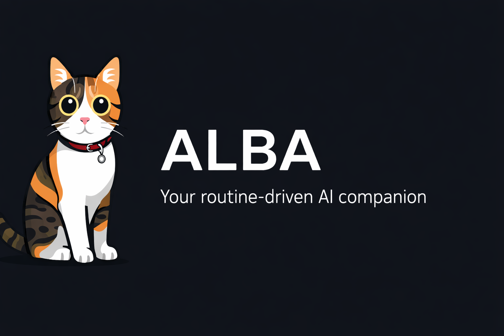
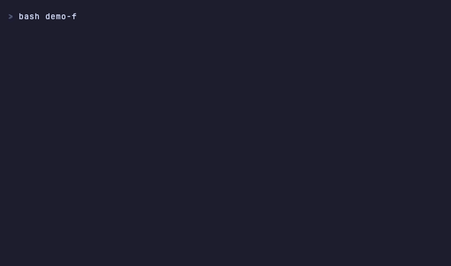

<p align="center">
  
</p>

<p align="center">
  <a href="README.md">English</a> | <a href="README.tr.md">Türkçe</a> | <a href="README.de.md">Deutsch</a> |
  <b>Português (BR)</b>
</p>

<p align="center">
  <a href="LICENSE"></a>
  <a href="https://docs.claude.com/en/docs/claude-code"></a>
  <a href="https://github.com/anthropics/claude-code/releases"></a>
  <a href="https://github.com/onurpolat05/ALBA/stargazers"></a>
</p>

---

O ALBA transforma o Claude Code em um **agente pessoal de IA** que lembra suas prioridades,
aprende com seus erros e se adapta ao seu fluxo de trabalho — seja você desenvolvedor,
gestor de projetos, pesquisador, fundador ou criador de conteúdo.

**Configuração interativa em 10 minutos. Sem gerenciador de pacotes, sem etapa de build,
sem nada para manter em execução — apenas scripts Bash e arquivos Markdown.**

<p align="center">
  
</p>

## O problema

Cada nova sessão do Claude Code começa do zero. Sem memória das prioridades de ontem.
Sem contexto sobre seus projetos. Os mesmos erros se repetem. Você precisa explicar
seu fluxo de trabalho novamente a cada sessão.

## A solução

```
you@machine:~/alba$ claude
> /setup
```

Responda a 7 perguntas. O ALBA cria um sistema de agente personalizado com memória persistente,
fluxos de trabalho automatizados e comportamento que melhora com o uso — adaptado ao seu papel.

## O que você recebe

```
your-agent/
├── CLAUDE.md                     # Cérebro do agente (< 200 linhas)
├── memory/
│   ├── state/                    # Prioridades, tarefas (atualizadas a cada sessão)
│   ├── knowledge/                # Aprendizados, erros, preferências (atualizados automaticamente)
│   ├── projects/                 # Contexto por projeto
│   └── daily/                    # Registros de sessão (criados automaticamente)
├── .claude/
│   ├── skills/                   # 9 skills integradas
│   ├── hooks/                    # 8 scripts automatizados para tratar eventos
│   ├── agents/                   # Definições de subagentes
│   ├── rules/                    # Diretrizes de comportamento (carregadas automaticamente)
│   ├── docs/                     # Documentação de referência (carregada sob demanda)
│   └── settings.json             # Registro de hooks + permissões
```

## Principais recursos

### Memória persistente

Memória em três níveis, baseada em arquivos, que permanece entre sessões. Versionada com Git,
legível por pessoas e sem dependências.

```
/start              → carrega suas prioridades da última sessão
  ... trabalho ...
/end                → salva o progresso, registra aprendizados
  ... dia seguinte ...
/start              → retoma exatamente de onde você parou
```

### 9 skills integradas

| Skill | Finalidade |
|-------|------------|
| `/start` | Iniciar a sessão — carregar contexto e mostrar prioridades |
| `/end` | Encerrar a sessão — salvar o estado e criar o registro diário |
| `/status` | Visão geral rápida — tarefas, impedimentos e última sessão |
| `/research` | Pesquisa na web com resultados estruturados (executada como subagente) |
| `/weekly-review` | Revisão semanal de desempenho e planejamento da próxima semana |
| `/extend` | Adicionar novas skills, hooks ou regras a qualquer momento |
| `/reflect` | Análise de padrões entre sessões |
| `/create-skill` | Assistente guiado para criar skills |
| `/setup` | Configuração inicial interativa |

### 8 hooks automatizados

| Evento do Claude Code | Script | O que acontece |
|---|---|---|
| `SessionStart` | `session-start.sh` | O painel é carregado e as prioridades são exibidas |
| `UserPromptSubmit` | `agent-suggest.sh` | Uma skill relevante é sugerida para o que você digitou |
| `PreToolUse` | `bash-validator.sh` | Um comando destrutivo é bloqueado antes de ser executado |
| `PostToolUse` | `error-logger.sh` | Falhas do Bash são registradas para detectar padrões |
| `PostToolUseFailure` | `error-logger.sh` | Falhas de Edit/Write/MCP também são registradas |
| `Stop` | `memory-check.sh` | Lembrete para salvar o estado — com frequência limitada, não a cada turno |
| `SessionEnd` | `session-end.sh` | Registro factual no diário de hoje, mesmo sem usar `/end` |
| `PreCompact` / `PostCompact` | `pre-compact.sh`, `post-compact.sh` | As prioridades sobrevivem à compactação do contexto |

Nove registros, oito scripts — `error-logger.sh` está associado aos dois eventos de falha de
ferramentas.

**Sobre o validador:** ele bloqueia uma lista curta de comandos realmente destrutivos e permanece
silencioso em todos os outros casos. Silencioso significa *silencioso* — nenhuma saída, código de
saída 0 e fluxo normal de permissões. Um hook `PreToolUse` que responde `"allow"` ignora
completamente a solicitação de permissão ao usuário. Assim, um validador que aprova tudo o que sua
lista de bloqueio não detecta é uma brecha, em vez de uma proteção. O ALBA tinha essa brecha
até a versão v2.0.0.

### Melhoria contínua

O ALBA aprende com seu trabalho:

- **Erros** são registrados automaticamente com suas soluções (para não repetir o mesmo erro)
- **Aprendizados** são capturados como padrões reutilizáveis
- **Preferências** são atualizadas quando você corrige o agente
- **`/reflect`** analisa padrões entre sessões e sugere novas regras

### Carregamento progressivo

O CLAUDE.md permanece com menos de 200 linhas. A documentação do sistema é carregada apenas quando
necessário, mantendo o uso eficiente da janela de contexto.

---

## Início rápido

### Opção 1: Template do GitHub (recomendada)

Clique em **"Use this template"** no GitHub e, em seguida:

```bash
git clone https://github.com/YOUR-USERNAME/YOUR-REPO.git my-agent
cd my-agent
claude
```

### Opção 2: Clonagem direta

```bash
git clone https://github.com/onurpolat05/ALBA.git my-agent
cd my-agent
rm -rf .git && git init
claude
```

### Depois:

```
/setup
```

Responda a 7 perguntas (~10 minutos). Seu agente personalizado está pronto.

**Aceite a caixa de diálogo de confiança ao abrir a pasta pela primeira vez.** Até você fazer isso,
o Claude Code ignora a lista `permissions.allow` em `settings.json`. Os hooks continuam funcionando,
mas você recebe solicitações de permissão para leituras e comandos que deveriam ocorrer sem
interrupções, dando a impressão de uma configuração com defeito em vez de uma pasta ainda não
marcada como confiável.

---

## Fluxo de trabalho diário

```
Manhã:
  /start                    # "Suas prioridades: 1. Prazo da API na sexta-feira  2. Revisar o PR #42"

Durante o trabalho:
  "pesquise padrões de múltiplos agentes"    # /research é executada como subagente
  "qual é o meu status?"                     # /status mostra uma visão geral rápida

Fim do dia:
  /end                      # Salva o progresso, registra aprendizados, cria o registro diário

Sexta-feira:
  /weekly-review            # Analisa a semana, planeja a próxima

A qualquer momento:
  /extend                   # "Quero uma skill para criação de conteúdo" → cria a skill
  /loop 30m /status         # Lembretes periódicos, limitados à sessão
```

---

## Comparação

| Recurso | Claude Code sem personalização | Outros projetos iniciais | ALBA |
|---------|--------------------------------|--------------------------|------|
| Memória entre sessões | Nenhuma | Parcial (apenas memória) | 3 níveis (state/knowledge/projects) |
| Configuração | Manual | Copiar e colar | Assistente interativo (7 perguntas) |
| Perfis atendidos | Genérico | Apenas desenvolvedores | Qualquer perfil (5 exemplos incluídos) |
| Melhoria contínua | Não | Não | Captura automática de erros e aprendizados |
| Hooks | Configuração manual | Alguns templates | 8 hooks, configurados automaticamente |
| Skills | Nenhuma integrada | Varia | 9 integradas, extensíveis |
| Eficiência do contexto | Não se aplica | Não se aplica | Carregamento progressivo (< 200 linhas) |
| Verificação da configuração | `/doctor` (sua instalação) | Não | `tools/doctor.sh` (a configuração em si) |

---

## Exemplos

Veja `examples/` para configurações completas e funcionais:

| Perfil | Foco |
|--------|------|
| **[Desenvolvedor](examples/developer/)** | Projetos de código, fluxos de trabalho com Git e pesquisa |
| **[Gestor de projetos](examples/project-manager/)** | Gestão de sprints, atualizações às partes interessadas e coordenação da equipe |
| **[Criador de conteúdo](examples/content-creator/)** | Calendário editorial, pesquisa e publicação em várias plataformas |
| **[Pesquisador](examples/researcher/)** | Revisão de literatura, gestão de fontes e acompanhamento de citações |
| **[Fundador](examples/founder/)** | Gestão de vários clientes, acompanhamento de receitas e marca pessoal |

Cada exemplo inclui painéis preenchidos, registros diários de exemplo e configurações de hooks
funcionais.

---

## Arquitetura

### Skills

Skills são arquivos Markdown com frontmatter YAML. O campo `description` não é decorativo — ele é
o único conteúdo que o Claude lê ao decidir se deve invocar uma skill. Por isso, as descrições do
ALBA indicam tanto quando ela deve ser acionada quanto quando não deve:

```yaml
---
name: research
description: Structured web research with cited sources. Use when user says
  "research X", "look into X". Do NOT use for single-fact lookups.
context: fork              # executa em um subagente, mantém o contexto principal limpo
agent: general-purpose     # tipo de subagente usado pelo fork
background: false          # aguarda o resultado neste turno (veja abaixo)
effort: medium
argument-hint: <topic> [deep]
allowed-tools: [Read, Write, Glob, Grep, WebSearch, WebFetch]
---
```

`context: fork` = tarefas pesadas são executadas como subagentes.
`context: inline` = tarefas rápidas são executadas na conversa principal.

**A armadilha de `background`.** Desde o Claude Code v2.1.218, `context: fork` usa
`background: true` por padrão — o subagente executa de forma independente e seu resultado não
retorna no turno que o invocou. Qualquer skill com fork escrita antes dessa versão mudou de
comportamento sem que uma única linha fosse alterada. As skills `/research` e `/reflect` do ALBA
definem `background: false` explicitamente, pois você fez uma pergunta e espera a resposta agora.
Esse também é o motivo pelo qual a versão mínima exigida pelo ALBA é v2.1.218.

Referência completa de frontmatter:
[`templates/skills/SKILL-TEMPLATE.md`](templates/skills/SKILL-TEMPLATE.md).

### Sistema de memória

```
HOT  (a cada sessão)            →  memory/state/dashboard.md, todo.md
WARM (ao aprender)              →  memory/knowledge/learnings.md, errors.md, preferences.md
COLD (por projeto)              →  memory/projects/[name]/context.md
LOGS (criados automaticamente)  →  memory/daily/YYYY-MM-DD.md
```

### Sistema de hooks

Hooks são scripts Bash acionados por eventos do Claude Code e registrados em `.claude/settings.json`.
Eles são executados automaticamente, sem necessidade de invocação manual. O Claude Code oferece
30 eventos de hooks; o ALBA usa nove e documenta todos em
[`templates/hooks/README-hooks.md`](templates/hooks/README-hooks.md).

Hooks falham silenciosamente. Um nome de evento escrito incorretamente, a ausência de um array
interno `hooks`, um caminho relativo que deixa de funcionar ao abrir uma sessão em um
subdiretório — nada disso produz um erro. O recurso simplesmente nunca funciona.
É para isso que existe o
`tools/doctor.sh`.

### Subagentes

`.claude/agents/` contém definições de subagentes — papéis nomeados aos quais o Claude pode delegar
trabalho. O ALBA inclui apenas um, `planner.md`, e o mantém simples de propósito. Não foi possível
demonstrar que os campos de frontmatter que alegam restringir as ferramentas de um agente realmente
impõem essas restrições. Por isso, a limitação está escrita como instrução, em vez de apresentada
como configuração. Se você precisa de um limite obrigatório, use `permissions.deny`: as regras de
bloqueio são avaliadas independentemente do que um agente ou hook solicitar.

### Fonte única de verdade

`templates/` é o único lugar que você edita. A árvore `.claude/` de cada perfil de exemplo é gerada
a partir dele:

```bash
tools/sync-examples.sh          # regenera examples/ a partir de templates/
tools/sync-examples.sh --check  # informa divergências sem alterar nada
tools/doctor.sh                 # verificação completa, execute antes do commit
```

Os arquivos específicos de cada perfil — `CLAUDE.md`, `README.md`, `memory/` — nunca são
sobrescritos; eles são a razão de existir de um exemplo. Antes da v2.0.0, cada script de hook
existia em seis lugares ao mesmo tempo, e a documentação dos exemplos estava uma versão inteira
atrás dos templates.

### Compatibilidade

- **Memória automática do Claude Code**: funciona em conjunto, sem conflitos
  ([detalhes](.claude/docs/memory-compatibility.md))
- **Agendamento com `/loop`**: tarefas periódicas limitadas à sessão
  ([detalhes](.claude/docs/loop-integration.md))
- **Servidores MCP**: opcionais (Trello, Gmail, Calendar, Exa, Firecrawl) — o ALBA funciona sozinho

---

## Expandindo o ALBA

Após a configuração, adicione recursos a qualquer momento:

```
/extend
```

Ou simplesmente peça em linguagem natural:

- "Quero uma skill para escrever rascunhos de e-mails"
- "Adicione um hook que faça commits automaticamente ao encerrar a sessão"
- "Crie uma regra com padrões de revisão de código"
- "Conecte meu quadro do Trello"

---

## Requisitos

- **Claude Code v2.1.218 ou superior.** Verificado com v2.1.220.
  [Instalação](https://docs.claude.com/en/docs/claude-code). A versão mínima não é arbitrária:
  o campo `background` para skills executadas com fork foi introduzido na v2.1.218. Sem ele,
  `/research` e `/reflect` retornam suas respostas a uma tarefa em segundo plano, em vez de a você.
- **Git**
- **jq** — usado pelos hooks para interpretar o JSON dos eventos. Sem ele, cada hook recorre a uma
  alternativa baseada em grep, mas instalar o jq exige apenas um comando.

Servidores MCP são melhorias opcionais — o ALBA funciona de forma totalmente independente.

Vai atualizar o Claude Code? Execute `tools/doctor.sh`. Ele verifica o que pode deixar de funcionar
silenciosamente entre versões: nomes de eventos de hooks, estrutura das configurações e caminhos de
scripts inexistentes.

---

## Configuração no Windows

Os hooks do ALBA são scripts Bash. O Claude Code funciona nativamente no Windows (sem exigir WSL)
e encaminha comandos Bash automaticamente pelo Git Bash, mas você precisa de alguns pré-requisitos:

```powershell
# 1. Instale o Git for Windows (inclui o Git Bash)
winget install --id Git.Git -e

# 2. Instale o jq (usado pelos hooks para interpretar JSON)
winget install --id jqlang.jq -e

# 3. Instale o Claude Code
irm https://claude.ai/install.ps1 | iex
```

Depois, clone o ALBA e execute `claude` na raiz do repositório — o Git Bash cuida do resto.

**Por que funciona:** o arquivo `.gitattributes` do ALBA força finais de linha LF em arquivos
`*.sh`, evitando o erro `bad interpreter: bash\r` que impede a execução de scripts Bash com a
configuração padrão de CRLF do Windows.

**Alternativa:** o WSL2 também funciona (com os mesmos passos de instalação dentro da distribuição
Linux). Use WSL2 se preferir um conjunto completo de ferramentas Linux.

**Solução de problemas:** se os hooks falharem com `command not found: jq`, instale o jq com o
comando acima. Se aparecer `bad interpreter`, seu clone é anterior ao `.gitattributes` — clone
o repositório novamente.

---

## Como contribuir

Contribuições são bem-vindas! Veja [CONTRIBUTING.md](CONTRIBUTING.md).

**Contribuições mais valiosas:**

- Configurações de exemplo para novos perfis
- Templates de skills personalizadas
- Receitas de hooks
- Guias de integração

Edite `templates/`, nunca `examples/` — depois execute `tools/sync-examples.sh` e `tools/doctor.sh`
antes de abrir um PR.

---

## Licença

Licença MIT — veja [LICENSE](LICENSE)

---

## Comunidade

- [GitHub Issues](https://github.com/onurpolat05/alba/issues) — Relatos de erros e pedidos de recursos
- [GitHub Discussions](https://github.com/onurpolat05/alba/discussions) — Perguntas e ideias

---

*ALBA — Consistente. Independente. Sempre aprendendo.*

> O nome é uma homenagem à gata Abla. *Alba* significa "amanhecer" em latim — um novo começo
> para seu fluxo de trabalho com IA.

## Histórico de estrelas

<a href="https://star-history.com/#onurpolat05/ALBA&Date">
 <picture>
   <source media="(prefers-color-scheme: dark)" srcset="https://api.star-history.com/svg?repos=onurpolat05/ALBA&type=Date&theme=dark" />
   <source media="(prefers-color-scheme: light)" srcset="https://api.star-history.com/svg?repos=onurpolat05/ALBA&type=Date" />
   
 </picture>
</a>
